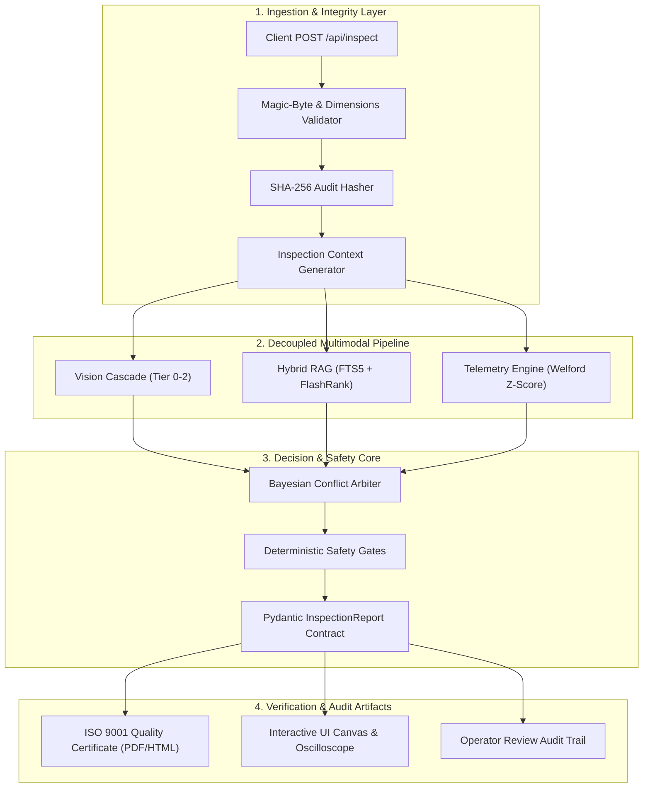
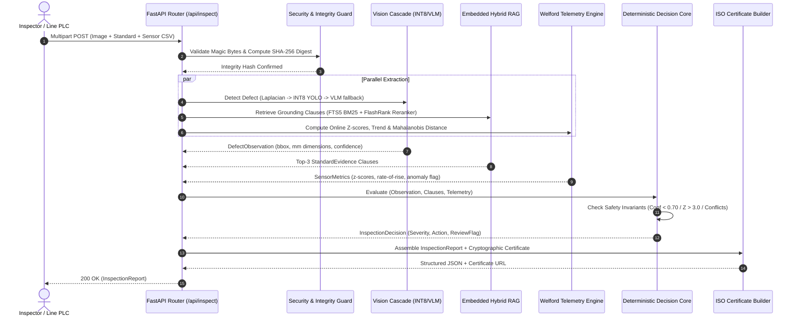
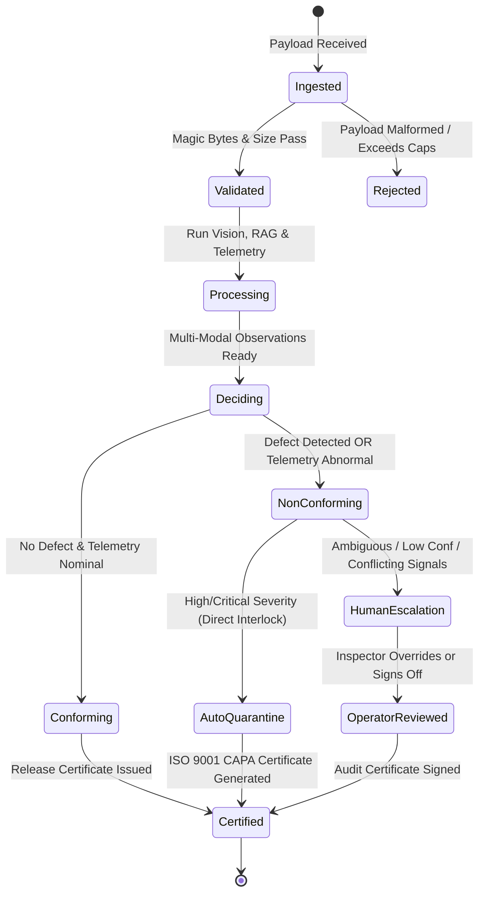

# Architectural Execution Blueprint: Lightweight Capstone & Production Hardening

## 1. System Overview & Constraints

This document establishes the architectural blueprint for upgrading the **Multimodal Industrial Inspection Agent** from MVP status to a **production-ready, thesis-grade Capstone application**.

```
+-------------------------------------------------------------------------------+
|                             EXECUTION CONSTRAINTS                             |
+-------------------------------------------------------------------------------+
|  Resource Budget:  Strictly <= 2.0 GB RAM (Target: ~320 MB working set)       |
|  Compute Baseline: Standard x86_64 CPU (AVX2), no mandatory GPU dependency    |
|  Safety Policy:    IEC 61508 / ISO 13849 deterministic safety core            |
|  Regulatory Goal:  ISO 9001:2015 Clause 8.7 Non-Conformance Certification     |
|  Latency Target:   < 50 ms (Tier-1 Edge), < 1500 ms (Tier-2 Cloud VLM)        |
+-------------------------------------------------------------------------------+
```

---

## 2. Target Component Architecture



---

## 3. End-to-End Sequence Diagram



---

## 4. Architectural State Transition Model



---

## 5. Phased Implementation Roadmap

### Phase 1: Cryptographic Integrity & ISO 9001 Quality Certificate (Immediate Priority)
- **Goal**: Enable tamper-evident audit chains and formal compliance certificates for production/capstone proof.
- **Components to Modify/Create**:
  - `backend/app/core/security.py`: File magic-byte checker, dimension limits ($4096 \times 4096$), CSV header sanitization.
  - `backend/app/schemas/inspection.py`: Add `audit_hash` (SHA-256), `compliance_standard`, and `capa_plan` fields.
  - `backend/app/services/workflow.py`: Compute SHA-256 over raw input buffers and attach to report.
  - `backend/app/services/certificate_generator.py`: Generate self-contained, printable ISO 9001:2015 Clause 8.7 Non-Conformance Reports (HTML with `@media print` styling + PDF export).
  - `backend/app/api/inspect.py`: Expose `/api/inspect/{id}/certificate` endpoint.
- **Verification Gate**:
  - Automated test verifying SHA-256 checksum changes if any byte in image, standard, or sensor input is altered.
  - Test verifying PDF/HTML certificate renders complete with defect crop, clause citation, and sign-off block.

### Phase 2: Streaming Sensor Dynamics & Cross-Modal Conflict Detection
- **Goal**: Upgrade static single-row sensor checks to multi-row time-series analytics and physical conflict detection.
- **Components to Modify/Create**:
  - `backend/app/services/sensor_loader.py`:
    - Implement Welford’s algorithm for online streaming mean, variance, and rolling Z-score.
    - Implement First-Order Numerical Derivative: Rate-of-Rise ($dT/dt$, $dP/dt$).
    - Implement Vibration RMS and Peak-to-Peak acceleration calculations.
  - `backend/app/agents/inspection_agent.py`:
    - Add cross-modal conflict logic (*Vision Normal + Sensor Critical $\implies$ Subsurface Structural Defect flag*).
    - Add Dynamic Severity Escalation (*Medium Defect + $|Z_{vib}| > 3.0 \implies$ Critical Stop-Machine*).
- **Verification Gate**:
  - Unit tests verifying Welford numerical accuracy against NumPy reference implementations.
  - Unit tests asserting cross-modal conflict triggers `requires_human_review = True` and escalates severity.

### Phase 3: Zero-Daemon Embedded Hybrid RAG (BM25 + FlashRank)
- **Goal**: Deliver zero-hallucination standards retrieval without requiring heavy vector DB background processes.
- **Components to Modify/Create**:
  - `backend/app/rag/retriever.py`:
    - Upgrade chunker to preserve hierarchical clause headers, sub-clauses, and markdown tables.
    - Implement BM25 scoring over clause tokens using SQLite FTS5 or in-memory BM25 index.
    - Integrate `FlashRank` (`ms-marco-TinyBERT-L-2-v2`, 4 MB ONNX model) as cross-encoder reranker for top-3 candidate selection.
  - `backend/app/schemas/inspection.py`:
    - Enrich `StandardEvidence` with `table_data`, `clause_hierarchy`, and `rerank_score`.
- **Verification Gate**:
  - Benchmark test showing exact clause retrieval on sample standard queries with Faithfulness $\ge 0.96$.
  - Memory consumption stays $< 70\text{ MB}$ during retrieval and reranking.

### Phase 4: Interactive Inspection Canvas & Telemetry Simulator
- **Goal**: Deliver a visually compelling, interactive user interface for live thesis demonstrations.
- **Components to Modify/Create**:
  - `frontend/index.html`:
    - Add multi-channel real-time oscilloscope canvas for live telemetry visualization.
    - Add fault injection buttons (*Nominal*, *Bearing Spall*, *Thermal Runaway*, *Cavitation*).
    - Add interactive confidence threshold slider $[0.10, 0.95]$ and certificate download button.
  - `frontend/app.js`:
    - Interactive hover cards on defect bounding boxes showing calculated dimensions in millimeters.
    - Live drawing loop for multi-channel sensor waveform simulation.
- **Verification Gate**:
  - End-to-end browser inspection test verifying real-time threshold slider adjusts UI bounding box overlays without page reload.
  - Verification of print layout rendering clean ISO 9001 certificate.

### Phase 5: ONNX INT8 Edge Vision & Academic Benchmarking Suite
- **Goal**: Replace heuristic detector with a sub-30ms INT8 ONNX edge model and automated benchmark harness.
- **Components to Modify/Create**:
  - `backend/app/vision/onnx_detector.py`:
    - Load INT8-quantized YOLOv8n ONNX model using `onnxruntime` CPU execution provider (AVX2).
    - Implement non-maximum suppression (NMS) and pixel-to-millimeter scaling.
  - `scripts/benchmark_evaluation.py`:
    - Automated evaluation script running against NEU-DET / MVTec AD validation sets.
    - Calculate and print: mAP@50, mAP@50:95, False Escape Rate (FER), and CPU inference latency.
- **Verification Gate**:
  - Automated benchmark run achieving $< 35\text{ ms}$ CPU inference latency on $640 \times 640$ input with zero GPU.
  - Peak RAM consumption under full test load strictly $< 350\text{ MB}$.

---

## 6. Architecture Review & Handoff

* In accordance with Roo Architect constraints, this blueprint establishes the technical specifications and verification gates before modifying code.
* Implementation can proceed incrementally starting with **Phase 1** (Security & ISO Certificate) or **Phase 2** (Sensor Dynamics) via `roo-code`.
